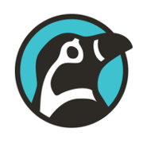
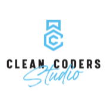
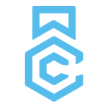
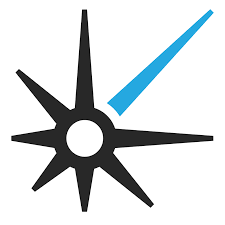

#### software craftsman, builder, and pilot.
Micah Martin is a software craftsman, entrepreneur, and pilot whose career spans software consulting, technical education, and aviation. He has built products and teams at companies including 8th Light, co-founded Clean Coders with Robert C. Martin, founded Clean Coders Studio, Airworthy, lemonGRAFT, and more.

### Social Media

### Blogs and Sites

* [Craftsman Series](http://micahmartin.com/craftsman-series) - Revival of Unclebob's "Craftsman" series from 2002 - 2010. 
* [Pendulums](http://micahmartin.com/pendulums) - A fun coupled pendulums simulator. 
* [Clean Coders Blog](https://cleancoders.com/blog) - Several blog entries published here.  Search for Micah. 
* [eflight Blog](http://micahmartin.com/eflight) - Blog adventures in developing electric airplanes. 
* [OneX Blog](http://micahmartin.com/onex) - Documents the construction of a OneX kit plane
* [8th Light Blog](https://8thlight.com/blog/micah-martin/) - blog entries while at 8th Light, Inc.
* [mmhttp](http://micahmartin.com/mmhttp) - JavaDoc for a simple HTTP server written in Java
* [Statemachine](http://micahmartin.com/statemachine) - Documentation for Ruby Statemachine Gem
* [Sparring](http://micahmartin.com/sparring) - Ruby Sparring results and documentation from a while back
* [Limelight](http://micahmartin.com/limelight/rdoc/) - Limelight RDoc ... long deprecated.

### Companies

     
    
Airworthy, <a href="http://airworthy.co">airworthy.co</a>, has a meandering history, and a promising future.

     
    
Clean Coders Studio, <a href="https://cleancoders.com/studio">cleancoders.com/studio</a>, is a software craftsmanship, contract development company.

     
    
lemonGRAFT, <a href="https:lemonGRAFT.com//">lemongraft.com</a>, is a digital marketplace for buying local, homegrown food. Shop in your neighborhood to find the most fresh, ethical, and nutritious foods on the market. .

     
    
Clean Coders, <a href="http://cleancoders.com">cleancoders.com</a>, is a partnership between my father and me where we make and sell educational software videos, with personality.

     
    
8th Light, <a href="http://8thlight.com">8thlight.com</a>, is a software development contracting company with focus on craftsmanship and apprenticeship.  As of Jan 2016 I'm no longer with 8th Light.

